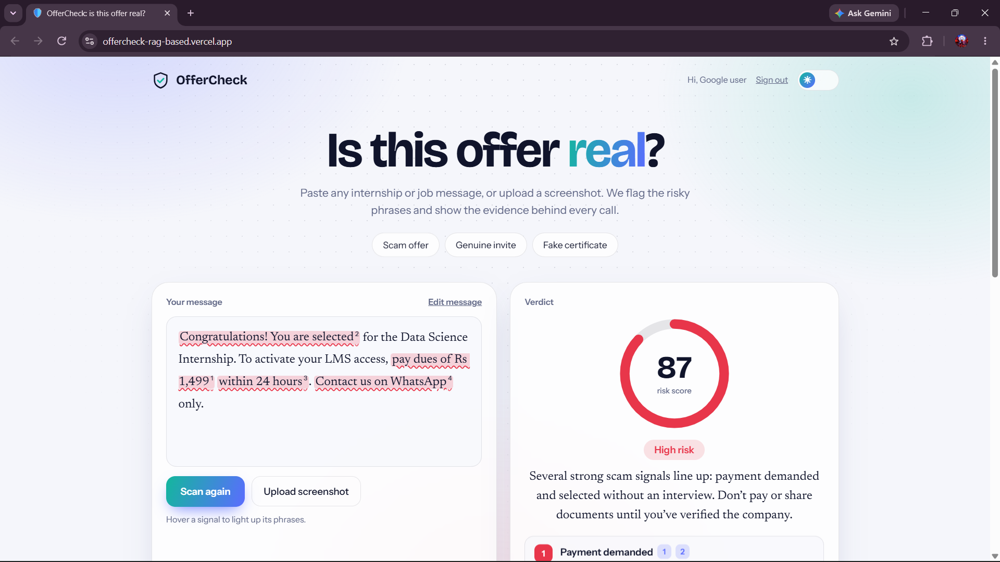
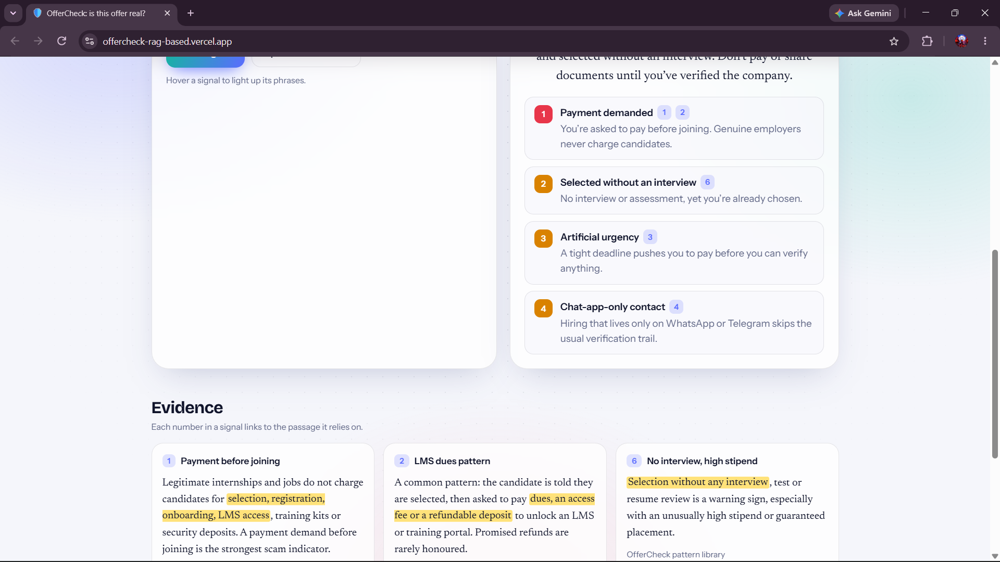
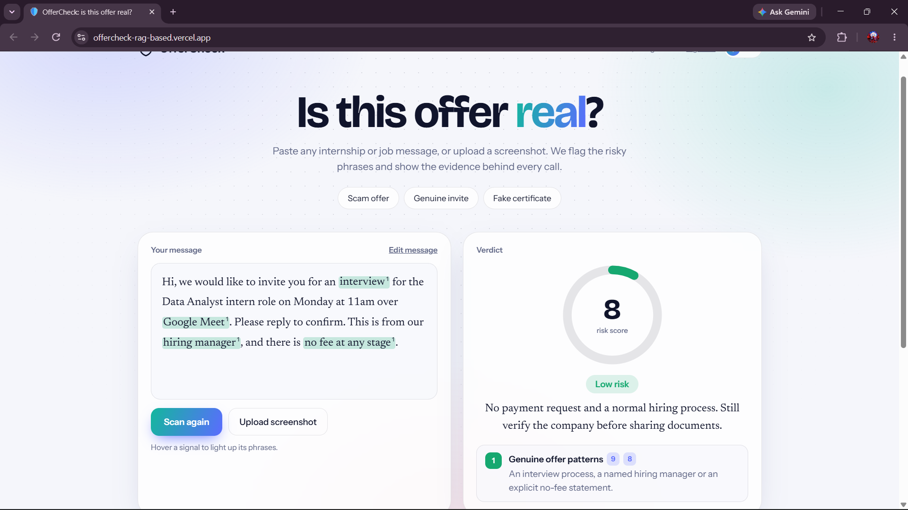
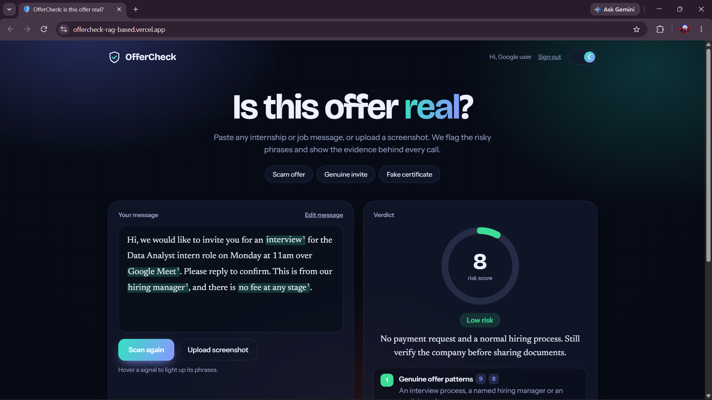
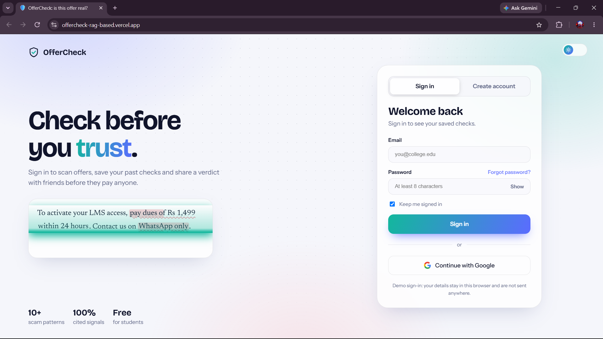

<div align="center">

# 🛡️ OfferCheck

**Is this internship or job offer real?**
Paste a message or upload a screenshot. OfferCheck highlights the risky phrases, scores the risk, and links every signal to the evidence behind it.

[](https://offercheck-rag-based.vercel.app)
[](LICENSE)


[Live demo](https://offercheck-rag-based.vercel.app) · [How it works](#-how-it-works) · [Quick start](#-quick-start) · [Deploy](#-deployment) · [Evaluation](#-evaluation)

</div>
## 📸 Preview

<div align="center">



</div>

| Cited evidence for every signal | A genuine offer scores low |
|---|---|
|  |  |

<details>
<summary>More screenshots</summary>





</details>
---

## Why this exists

Students in India regularly receive "internship offers" that ask them to pay a registration fee, a security deposit, or "dues to unlock your LMS" before they can start. These scams are polished, urgent, and hard to judge in the moment.

OfferCheck is a retrieval-augmented (RAG) fraud checker built for exactly this. Instead of just asking an LLM "is this a scam?", it grounds every verdict in a curated knowledge base of known scam patterns, and it **refuses to show claims it cannot back up**.

## ✨ Features

- **Paste text or upload a screenshot.** Screenshots are transcribed by a vision model first.
- **Risk score** for the whole message, with the exact risky phrases highlighted.
- **Evidence for every signal.** Each flag cites the knowledge-base passages behind it and quotes the phrase from your message.
- **Grounding guard.** Signals whose citations were never retrieved are dropped, and quotes that do not appear in the message are removed. The UI shows a **faithfulness score**.
- **Hybrid retrieval.** BM25 keyword search plus dense embeddings, fused with Reciprocal Rank Fusion (RRF).
- **Provider-agnostic.** Google Gemini by default, but any OpenAI-compatible LLM endpoint works.
- **Demo mode.** With no API key, the server falls back to built-in rules so the app always runs.
- **Built-in evaluation harness** comparing LLM-only against RAG.

## 🧠 How it works

````
 message / screenshot
          │
          ▼
 ┌─────────────────┐   screenshots are transcribed
 │  1. Extract     │◄─ by a vision model first
 │  claims (LLM)   │
 └────────┬────────┘
          ▼
 ┌─────────────────┐   BM25 + embeddings,
 │  2. Retrieve    │   fused with RRF
 │  KB passages    │
 └────────┬────────┘
          ▼
 ┌─────────────────┐   uses ONLY retrieved passages;
 │  3. Judge       │   cites passage ids + exact phrase
 └────────┬────────┘
          ▼
 ┌─────────────────┐   drops uncited signals,
 │  4. Grounding   │   strips quotes not in the message,
 │     guard       │   computes faithfulness
 └────────┬────────┘
          ▼
   risk score + highlighted, cited signals
````

1. **Extract** claims from the message with the LLM.
2. **Retrieve** matching passages from the knowledge base with hybrid search.
3. **Judge** using only the retrieved passages. Each signal cites passage ids and quotes the exact phrase from the message.
4. **Guard.** Signals with citations that were not retrieved are dropped, and quotes that are not in the message are removed.

## 🧰 Tech stack

| Layer | Technology |
|---|---|
| Frontend | React, TypeScript, Vite |
| Backend | Node.js, Express, TypeScript |
| Validation | zod |
| Retrieval | BM25 + dense embeddings, fused with RRF |
| LLM | Google Gemini (default) or any OpenAI-compatible API |
| Deploy | Render (API + app), Vercel (frontend only) |

## 🚀 Quick start

**Requirements:** Node.js 20 or newer.

````bash
git clone https://github.com/manthan707-ds/Offercheck-RAG-based.git
cd Offercheck-RAG-based

cp .env.example server/.env     # add LLM_API_KEY (optional)
npm install
npm run dev
````

| Service | URL |
|---|---|
| Web app | http://localhost:5173 |
| API | http://localhost:8787 |

No API key? The app still runs in **demo mode** using built-in rules. Add a key for full LLM-powered analysis.

## ⚙️ Configuration

Copy `.env.example` to `server/.env` and set:

| Variable | Required | Description |
|---|---|---|
| `LLM_API_KEY` | No* | API key. Get a Gemini key at [aistudio.google.com](https://aistudio.google.com). *Without it the app runs in demo mode. |
| `LLM_BASE_URL` | No | OpenAI-compatible base URL. Defaults to Gemini: `https://generativelanguage.googleapis.com/v1beta/openai` |
| `LLM_MODEL` | No | Model name, e.g. `gemini-3.5-flash-lite` |
| `LLM_REASONING` | No | Reasoning mode passed to the model (default `none`) |
| `EMBED_MODEL` | No | Embedding model. Setting this with `EMBED_BASE_URL` enables dense retrieval. |
| `EMBED_BASE_URL` | No | Any OpenAI-compatible `/embeddings` endpoint, e.g. Ollama at `http://localhost:11434/v1` |
| `PORT` | No | API port (default `8787`) |
| `VITE_API_URL` | Vercel only | Set at build time to your API URL so the frontend can reach it |

## 📜 Scripts

| Command | What it does |
|---|---|
| `npm run dev` | Runs API and web app together with hot reload |
| `npm run build` | Builds the React client |
| `npm start` | Starts the production server (also serves the built client) |
| `npm run typecheck` | Type-checks server and client |
| `npm run eval` | Runs the evaluation: LLM-only vs RAG |

## ☁️ Deployment

### Option A: One service on Render (recommended)

The Express server also serves the built React app, so a single free web service is enough.

1. Push this repo to GitHub.
2. On Render choose **New → Blueprint** and select the repo. `render.yaml` configures everything, including the `/api/health` health check.
3. Add the `LLM_API_KEY` environment variable in the Render dashboard.
4. Optional: add `EMBED_MODEL` and `EMBED_BASE_URL` for dense retrieval.

Any Node host works too:

````bash
npm install --include=dev && npm run build
npm start
````

### Option B: Frontend on Vercel, API on Render

Deploy the API on Render as above, then deploy the frontend on Vercel with this build-time variable:

````
VITE_API_URL=https://your-app.onrender.com
````

> The Render free tier sleeps when idle, so the first request after a pause can take a while.

## 📊 Evaluation

````bash
npm run eval
````

Compares **LLM-only** against **RAG (hybrid retrieval + grounding guard)** on precision, recall, F1, and faithfulness, using `server/eval/dataset.json`.

| System | Precision | Recall | F1 | Faithfulness |
|---|---|---|---|---|
| LLM only | – | – | – | n/a |
| RAG (hybrid + guard) | – | – | – | – |

> Results will be added here once the labelled dataset has grown to 150+ real messages. Numbers from a tiny dataset would not be meaningful.

## 📚 Improving the knowledge base

The knowledge base lives in `server/src/kb/seed.json`. To add a scam pattern:

- Add a passage with a clear description of the pattern.
- Include a `url` pointing to a real source (news report, advisory, or official notice).
- Add a `key` phrase so the UI can highlight it in user messages.

Quality of sources matters more than quantity, because every flag shown to a user traces back to these passages.

## ⚠️ Limitations and disclaimer

- OfferCheck reports **risk signals only**. It cannot cryptographically verify a certificate or confirm that a company is genuine.
- A low risk score is not a guarantee that an offer is real. A high score is not proof of fraud.
- Always confirm with the issuer directly, using contact details you found yourself (not ones from the message).
- Never pay money to secure an internship or job.

## 🗺️ Roadmap

- [ ] Grow the labelled evaluation set to 150+ messages and publish results
- [ ] Expand the sourced knowledge base with more Indian scam patterns
- [ ] Multi-language support (Hindi and other regional languages)
- [ ] Check sender email domain and company registration signals
- [ ] Browser extension and WhatsApp/Telegram forwarding

## 🤝 Contributing

Contributions are welcome, especially **real, sourced scam examples** for the knowledge base and evaluation set.

1. Fork the repo and create a branch: `git checkout -b feature/my-change`
2. Make your changes and run `npm run typecheck`
3. Open a pull request describing what you changed and why

## 📄 License

Released under the [MIT License](LICENSE).

---

<div align="center">

Built to help students spot fake offers before they pay. If this helped you, consider giving it a ⭐

</div>
````
````

Copy only what's inside the box, without the outer four-backtick lines. Then on GitHub, open `README.md` and click the pencil icon. Select all the old text with Ctrl+A, paste this in, and commit to `main`.

The Roadmap section is placeholder text I wrote, so edit or delete it before you commit.
